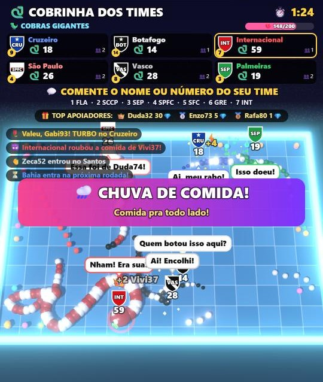

# Lives TikTok

**Jogos para live no TikTok em que o público controla a partida.** Comentários, curtidas e presentes de quem assiste viram ações no jogo, em tempo real, e a live roda sozinha, sem ninguém operando.



## O problema

Live parada não segura ninguém: o público só fica e interage quando acontece alguma coisa na tela por causa dele. Aqui cada comentário, curtida ou presente muda o jogo na hora, e a narradora agradece cada apoio pelo nome. Isso dá motivo para o público participar e mandar presentes.

## Os jogos

**Cobrinha dos Times 3D**
- 14 times brasileiros e até 6 cobras na arena. Comentar o nome ou o número do time coloca a pessoa nele e solta comida com o nome dela.
- Curtida vira comida, presente vira TURBO e presente grande vira MEGA COBRA. A cada 200 curtidas, chove comida.
- Cada rodada sorteia um modo (Clássica, Turbo, Cobras Gigantes, Campo Minado, Arena Encolhendo, Noite Neon e outros) e um cenário. Surpresas aparecem no meio da partida.

**Corrida dos Times**
- Cada comentário vira uma bolinha que desce uma pista com física, e a pista muda a cada corrida.
- Presentes dão impulso ao time de quem mandou.

**Nos dois**
- Narradora com voz sintética, que agradece todo presente e fala o nome de quem apoiou.
- Ranking "Top Apoiadores" do dia.
- Painel de teste com plateia automática (bots), para testar sem estar ao vivo.

## Segurança da live

- O sistema só **lê** a live, como um espectador: não usa senha e não posta nada.
- Nomes com palavrão ou ofensa aparecem como "Torcedor".
- A narradora só fala frases prontas mais o nome da pessoa, já filtrado. Ela nunca lê comentários em voz alta nem pede presente.
- Escudos desenhados por padrão, fotos de perfil desligadas, sem aposta e sem prêmio, música própria.

## Como funciona

```
TikTok LIVE ──> server.js (Node.js) ──WebSocket──> jogos no navegador ──> captura de janela no LIVE Studio
```

O `server.js` se conecta à live com `tiktok-live-connector`, recebe os comentários, curtidas e presentes e repassa tudo por WebSocket para o jogo aberto no navegador. O jogo é capturado pelo TikTok LIVE Studio como uma janela.

## Stack

| Parte | Tecnologia |
| --- | --- |
| Servidor | Node.js, `ws` (WebSocket), `tiktok-live-connector` |
| Cobrinha 3D | Three.js |
| Corrida | Matter.js (física 2D) |
| Voz | Web Speech API do navegador |

## Rodando

```bash
npm install
npm run teste            # modo teste, sem TikTok
npm start -- seu_usuario # conecta na live de @seu_usuario
```

Abra http://localhost:3000, escolha o jogo e clique na tela para liberar o som. No modo teste, aperte **T** e marque "Plateia automática".

Atalhos: **M** som · **V** voz · **F** tela cheia · **G** volta para a galeria.

---

Feito por [Daniel D'Azevedo](https://dazevedo.dev) · DAZEVEDO
